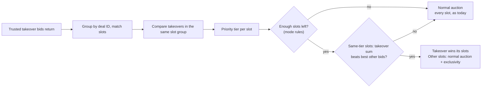

# Page Takeover Module — Prebid Spec

**Status:** Draft v0.3 · 2026-11-18 · Proposed design for [prebid/Prebid.js#15719](https://github.com/prebid/Prebid.js/issues/15719), updated after maintainer feedback there

## Problem

Today no open-market auction lets one buyer win several ad slots on the same page together. Prebid and OpenRTB auction each slot (`imp`) on its own, and a bidder has no way to say "these slots together, or none."

This costs publishers money. Buyers often exclude cluttered pages, for example sites with more than 4 ad slots in the viewport, because their ad gets lost among the others. If a buyer could win every slot on that page at once, the same page would become a memorable, high-impact impression instead of a site the buyer blocks.

The only way to buy a whole page today is a roadblock in Google Ad Manager, and for programmatic buying [GAM supports roadblocks only as Programmatic Guaranteed deals](https://support.google.com/admanager/answer/10848368). Each one is negotiated with a single publisher, so whole-page buying can't scale across the open web.

This spec proposes an optional **takeover module** for Prebid.js: one buyer can win every matching slot on a page view through a takeover deal, when it outranks the normal per-slot auction on those slots.

## Decisions from the #15719 discussion

| Topic | Decision for v1 |
| --- | --- |
| Packaging | Optional module, with minimal core hooks where needed. |
| Modes | `all`, `max` (with `min_slots`) and `viewport`. |
| Auction scope | All slots of a takeover are in one `requestBids` call. Slot groups across auctions come later. |
| Comparison | Priority tier first on each slot; within a tier, the takeover's summed desirability against the sum of the best other bids. Two takeovers in the same slot group are compared directly first. |
| Bid shape | Alternative (2): the takeover bids on each slot with markup sized for that slot. Alternative (1), one bid with creatives for every slot, is a later extension. |
| Accepted from | Configurable: all deal bidders, an allowlist, or priority bidders only (the default). |
| Refresh | Optional blocking of refresh on taken-over slots, off by default. |

## How this builds on current Prebid work

| Prebid work | Status | What this spec takes from it |
| --- | --- | --- |
| [#15602](https://github.com/prebid/Prebid.js/issues/15602): standard deal metadata, `ext.prebid.deal` normalized to `bid.meta.deal` | Done (`meta.deal` shipped in 11.43) | Takeover fields live inside the same object: `ext.prebid.deal.takeover`. |
| [#15816](https://github.com/prebid/Prebid.js/pull/15816): priority bids (`allowPriorityBids`, `bid.priority`, `priorityAdjustedCpm`) | Merged Oct 2026 | Priority tiers and `priorityAdjustedCpm` drive the comparison. `allowPriorityBids` defines the default set of trusted takeover bidders. |
| [#15719](https://github.com/prebid/Prebid.js/issues/15719): whole page take over on deal response | Open, in discussion | This spec is a proposed design for it. |

## Goals and non-goals

Goals:

- One buyer wins **every slot**, **every slot in view**, or **as many matching slots as possible** on a page view.
- Use Prebid's existing priority and desirability ranking. No new ranking system.
- Optional **exclusivity** keeps named competitors or categories out of the page's other slots.
- Analytics can report a takeover as one unit as well as per slot.
- Open source (Apache 2.0, the same license as Prebid.js).

Non-goals for v1:

- Takeovers spanning several `requestBids` calls.
- One bid carrying creatives for several slots (alternative (1)).
- Letterboxing (serving a smaller creative in a larger slot). Sizes must match.
- Video, native and CTV ad pods. Banner only.
- Changing how GAM runs its own auction (AdX and direct line items). The module works through key-values and line items.

## Modes

| Mode | Slots the takeover covers | Slot without takeover markup |
| --- | --- | --- |
| `all` | Every ad unit in the `requestBids` call. | The takeover is invalid. |
| `max` | As many slots as it can win, at least `min_slots`. | Runs the normal auction, with exclusivity applied. |
| `viewport` | Every ad unit in view when `requestBids` runs. Slots out of view run the normal auction. | Runs the normal auction, with exclusivity applied. |

For `all`, a publisher option (`collapseUnfilled`) can collapse a slot without markup instead of making the takeover invalid.

Following #15719, a mode `all` takeover is also rejected if any slot on the page has already rendered another bid, for example a lazy-loaded or refreshed slot.

## Slot matching and grouping

- **Grouping:** bids belong to the same takeover when they share a `dealId` and come from the same bidder, within one `requestBids` call. The takeover's **group id** is built from the auction id, bidder and deal id, and is attached to each of its bids.
- **Markup per slot:** each bid carries markup sized for its own slot, so no `adm` array or multi-slot renderer is needed. A slot is matched only if the takeover returned a bid for it in a size the slot accepts.
- **Repeated sizes:** one creative can fill several slots of the same size. Each slot's bid carries its own copy, because GAM won't serve the same creative twice on a page.
- **Flex / fluid slots:** no special handling. A takeover bid fills a fluid slot like any other bid, as long as its markup is responsive.

Example in mode `max` with 6 slots and a takeover deal with 3 sizes (728x90, 300x250, 300x600):

| Slot | Accepts | Result |
| --- | --- | --- |
| top | 728x90, 970x250 | Takeover (728x90) |
| right-1 | 300x250, 300x600 | Takeover (300x600) |
| right-2 | 300x250 | Takeover (300x250) |
| in-content | 300x250 | Takeover (300x250, second copy) |
| skyscraper | 160x600 | Normal auction |
| footer | 970x90 | Normal auction |

## Takeover fields in the deal object

A takeover is a set of ordinary per-slot deal bids. Each carries the same `dealid`, and its `ext.prebid.deal` object carries a `takeover` member. The shared OpenRTB converter normalizes it to `bid.meta.deal.takeover`, in camel case, alongside the existing deal fields.

```json
{
  "impid": "imp-1",
  "dealid": "TKO-ACME-01",
  "price": 18.00,
  "w": 300,
  "h": 250,
  "ext": {
    "prebid": {
      "deal": {
        "type": 3,
        "cpm": 18.00,
        "takeover": {
          "mode": "viewport",
          "min_slots": 3,
          "exclusivity": {
            "adomain": ["opponent.com"],
            "cat": ["IAB11-4"]
          }
        }
      }
    }
  }
}
```

| Field (OpenRTB → `meta.deal.takeover`) | Type | Meaning |
| --- | --- | --- |
| `mode` → `mode` | `all`, `max` or `viewport` | See Modes. Default `max`. |
| `min_slots` → `minSlots` | integer | The takeover is dropped if it wins fewer slots. Used in `max` and `viewport`. |
| `exclusivity.adomain` → `exclusivity.adomain` | array | Advertiser domains blocked from the other slots on the page. |
| `exclusivity.cat` → `exclusivity.cat` | array | IAB content categories blocked from the other slots on the page. |

Everything else comes from fields that already exist: the grouping key is `bid.dealid` (with the bidder), the price per slot is `bid.price`, and priority and `priority_adjusted_cpm` are the existing `ext.prebid.deal` fields.

## Which bidders can send takeovers

Takeover fields are acted on only for bidders the publisher accepts them from (`acceptFrom`):

| Setting | Takeovers accepted from |
| --- | --- |
| `priority` (default) | Bidders trusted for priority bids: `bidderSettings[adapterCode].allowPriorityBids` (client) or `s2sConfig.allowPriorityBids` (Prebid Server). |
| `allowlist` | Only the bidder codes listed in `acceptFromBidders`. |
| `deals` | Any bidder, for bids with a deal ID. |

Takeover fields from other bidders are ignored, and their bids compete normally. A takeover changes what serves in slots the bidder didn't bid on, so the default is the strictest setting.

## Decision rule

The comparison uses Prebid's existing ranking: priority tier first, then desirability within a tier.



**Step 1: takeovers against each other.** If two takeovers want the same slot group, they're compared directly first, by priority, then total desirability. The loser is dropped, not split.

**Step 2: priority tier on each slot.** For every slot the takeover matched, compare the takeover's bid with the best other bid on that slot (`bid.priority`, lower wins):

- **Takeover in a higher tier:** the takeover takes the slot.
- **Takeover in a lower tier:** the slot is lost. In mode `all` this makes the takeover invalid. In `max` and `viewport` the slot drops out, and the takeover must still have at least `min_slots`.
- **Same tier:** the slot goes to step 3.

**Step 3: desirability within the tier.** Over the same-tier slots, the takeover wins only if:

```math
\sum_{i} \text{takeoverDesirability}_i > (1 + p) \cdot \sum_{i} \text{bestOtherDesirability}_i
```

- takeoverDesirability = the takeover bid's desirability on each slot: `priorityAdjustedCpm` when present, otherwise CPM, after the usual adjustments.
- bestOtherDesirability = the desirability of the best other bid on that slot (the slot's floor if there is none).
- p = an optional publisher premium (default 0).

If step 3 fails, the takeover loses all its same-tier slots. In mode `all` that means the whole takeover.

**Exclusivity cost:** if the takeover blocks advertisers from the other slots, the best bids lost on those slots are added to the right-hand side. The takeover pays for what it blocks.

**Ties** go to the normal auction.

**Limit:** Prebid only sees header bids, not AdX or direct line items in GAM. A takeover that wins in Prebid can still lose a slot inside GAM. The GAM handoff below is designed to prevent this.

## Analytics

Each slot's bid keeps its own price, so per-slot analytics stay normal: there's no single huge bid with zeros elsewhere.

- **Group id on each bid:** `bid.meta.deal.takeover.groupId`, so analytics adapters can join a takeover's slots.
- **Group-level event:** the module emits `TAKEOVER_RESULT` once per takeover, with the group id, mode, result (won or lost, and why), slots won, and total CPM.

## Refresh

Option `blockRefresh` (default `false`): while a takeover is on the page, refreshes of its slots that go through Prebid (`requestBids` on those ad units) are skipped, so the takeover stays intact. Publisher refreshes that bypass Prebid are out of the module's control.

## GAM handoff

When a takeover wins, the module sets key-values on each won slot so that dedicated takeover line items in GAM serve it ahead of AdX.

| Key | Example value | Purpose |
| --- | --- | --- |
| `hb_tko` | `1` | Marks the slot as won by a takeover. |
| `hb_deal` | `TKO-ACME-01` | Standard Prebid deal key; ties the slots together for reporting. |
| `hb_pb` | `18.00` | Price bucket, as standard Prebid. |
| `hb_excl` | `pol-opp` | Turns on the GAM competitive exclusion label for the other slots. |

Publisher setup in GAM:

1. **Single-request mode (SRA) on.** GAM needs every slot in one request to serve slots as a group.
2. **Takeover line items** targeted to `hb_tko=1`, at a priority above price priority and AdX (for example Sponsorship), using the Prebid Universal Creative.
3. **"Display creatives" setting:** "All" for mode `all`, "As many as possible" for `max` and `viewport`.
4. **Competitive exclusion labels** mapped to `hb_excl` values, to enforce exclusivity on the other slots.

## Publisher config

```javascript
pbjs.setConfig({
  takeover: {
    enabled: true,
    acceptFrom: 'priority',          // 'priority' | 'allowlist' | 'deals'
    acceptFromBidders: [],           // used with 'allowlist'
    modes: ['all', 'max', 'viewport'],
    minSlotsFloor: 2,                // ignore takeovers that ask for fewer slots
    premium: 0,                      // optional margin within a priority tier
    excludeAdUnits: ['footer'],      // slots never taken over
    collapseUnfilled: false,         // mode 'all': collapse slots without markup
    blockRefresh: false,
    allowExclusivity: true,
    exclusivityLabels: { 'pol-opp': ['IAB11-4'] }
  }
});
```

| Setting | Default | Meaning |
| --- | --- | --- |
| `acceptFrom` | `'priority'` | Which bidders' takeovers are accepted. |
| `acceptFromBidders` | none | Bidder codes for `allowlist`. |
| `modes` | `['max']` | Which takeover modes are accepted. |
| `minSlotsFloor` | 2 | Takeovers asking for fewer slots are ignored. |
| `premium` | 0 | Extra margin a takeover must beat within a priority tier. |
| `excludeAdUnits` | none | Slots never taken over. |
| `collapseUnfilled` | false | In mode `all`, collapse a slot without markup instead of rejecting the takeover. |
| `blockRefresh` | false | Skip Prebid refreshes on taken-over slots. |
| `allowExclusivity` | false | Whether takeovers may block advertisers from other slots. |
| `exclusivityLabels` | none | Maps `hb_excl` values to the categories they block. |

## Demand path: takeovers through deal IDs

Buyers send takeover bids through ordinary private marketplace (PMP) deals, so no DSP needs to change.

1. **The publisher (or SSP) creates a takeover deal**, for example `TKO-ACME-01`, with its takeover terms: mode, `min_slots`, exclusivity, and optionally a priority.
2. **The buyer targets the deal in their DSP** with a fixed CPM per slot, using a creative for each matching size.
3. **The DSP bids on each slot separately**, as for any PMP deal, with the same deal ID on every bid.
4. **The SSP (its Prebid adapter, or Prebid Server) adds `ext.prebid.deal.takeover`** to each bid on the deal.
5. **The module groups the accepted bids by deal ID** and applies the decision rule.

Limits:

- **Missing bids:** the DSP decides each slot's bid separately, so it may not bid on every slot (pacing, frequency caps, brand-safety filters). Buyers should turn off per-page frequency caps on takeover deals. `max` and `viewport` tolerate missing slots; `all` does not.
- **Per-slot prices only:** the takeover total is the sum of its per-slot bids.

## Later extensions

- **Slot groups across `requestBids` calls**, for lazy-loaded pages.
- **Alternative (1):** one bid carrying creatives for several slots, for bidders that support it natively. It would require an explicit per-slot price split in the response, so analytics stay sane.
- **Prebid Server:** running the takeover rule server-side, where all of a request's slots are seen at once. This would bring takeovers to apps and CTV.
- **CTV pod takeovers:** one buyer takes a whole ad break.

## Open questions

1. Which core hooks does the module need? Likely: a point after all bids return but before targeting is set, and a way to skip refreshes.
2. How should `viewport` decide what's in view: a fresh check when `requestBids` runs, or a viewability signal the publisher passes in?
3. Should `TAKEOVER_RESULT` be a new core event, or module-specific?

## Contribution plan (Prebid.js rules)

Prebid's [contributing guide](https://github.com/prebid/Prebid.js/blob/master/CONTRIBUTING.md) shapes how this is built:

- **Fork and pull request** against `master` in `prebid/Prebid.js`.
- **Test coverage above 80%** on added code, with all existing tests passing. Tests use Mocha, Chai and Sinon.
- **TypeScript types** for the public interface: the `takeover` config block and `meta.deal.takeover`.
- **Docs** go in a separate pull request to [prebid.github.io](https://github.com/prebid/prebid.github.io).

Draft types:

```typescript
export type TakeoverMode = 'all' | 'max' | 'viewport';

export interface TakeoverExclusivity {
  adomain?: string[];
  cat?: string[];
}

export interface TakeoverMeta {
  mode?: TakeoverMode;        // default 'max'
  minSlots?: number;          // used in 'max' and 'viewport'
  exclusivity?: TakeoverExclusivity;
  groupId?: string;           // set by the module
}

// Added to the existing deal metadata on bid.meta.deal
export interface DealMeta {
  // existing fields: type, cpm, priorityAdjustedCpm, onSchedule, priority
  takeover?: TakeoverMeta;
}

export interface TakeoverConfig {
  enabled: boolean;
  acceptFrom?: 'priority' | 'allowlist' | 'deals';  // default 'priority'
  acceptFromBidders?: string[];
  modes?: TakeoverMode[];     // default ['max']
  minSlotsFloor?: number;     // default 2
  premium?: number;           // default 0
  excludeAdUnits?: string[];
  collapseUnfilled?: boolean; // default false
  blockRefresh?: boolean;     // default false
  allowExclusivity?: boolean; // default false
  exclusivityLabels?: Record<string, string[]>;
}
```

Test plan, one `describe` block per area:

- **Normalization and trust:** `ext.prebid.deal.takeover` to `meta.deal.takeover`; malformed fields ignored; each `acceptFrom` setting.
- **Grouping and matching:** by deal ID and bidder; repeated sizes; fluid slots; unmatched slots.
- **Modes:** `all` (including missing markup, `collapseUnfilled`, and an already-rendered slot), `max` with `minSlots`, `viewport`.
- **Decision rule:** takeover against takeover; higher, lower and same tier per slot; the sum comparison; premium; exclusivity cost; ties.
- **Analytics:** group id on each bid; `TAKEOVER_RESULT` contents.
- **Refresh:** `blockRefresh` on and off.
- **Targeting:** `hb_tko` and `hb_excl` set only on won slots.

## Roadmap

- [x] Check Prebid.js issues for earlier proposals: found [#15719](https://github.com/prebid/Prebid.js/issues/15719)
- [x] Share the spec on #15719 and get maintainer feedback
- [ ] Settle the open questions on #15719
- [ ] Build the module on a fork of Prebid.js, tested with mock takeover bids
- [ ] Submit upstream to Prebid.js, with tests and a docs page on docs.prebid.org

Interested in helping, as a publisher, SSP or buyer? Open an issue in this repo.

## Sources

- [Prebid.js #15719: Whole page take over on deal response](https://github.com/prebid/Prebid.js/issues/15719)
- [Prebid.js #15602: Standardize deal metadata and sponsorship-aware selection](https://github.com/prebid/Prebid.js/issues/15602)
- [Prebid.js PR #15816: Priority bids](https://github.com/prebid/Prebid.js/pull/15816)
- [GAM: Roadblock creatives](https://support.google.com/admanager/answer/2666920)
- [GAM: Programmatic Direct creatives and roadblocks](https://support.google.com/admanager/answer/10848368)
- [Prebid.js contributing guide](https://github.com/prebid/Prebid.js/blob/master/CONTRIBUTING.md)
