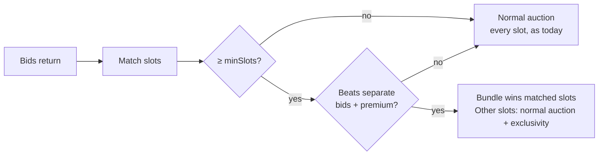

# Page Bundle Auction — Prebid Module Spec

**Status:** Draft v0.1 · 2026-11-14

## Problem

Today no open-market auction lets one buyer win several ad slots on the same page together. Prebid and OpenRTB auction each slot (`imp`) on its own, and a bidder has no way to say "these slots together, or none."

The only way to buy a whole page is a roadblock in Google Ad Manager, and for programmatic buying [GAM supports roadblocks only as Programmatic Guaranteed deals](https://support.google.com/admanager/answer/10848368). Each one is negotiated with a single publisher, so whole-page buying can't scale across the open web.

This module adds an open-source **page bundle auction** to Prebid.js. One buyer can bid for every matching slot on a page view. The bundle wins only when it pays the publisher more than the normal per-slot auction would.

## Goals and non-goals

Goals:

- One buyer wins **as many matching slots as possible** on a page view, with a minimum count the buyer sets.
- The publisher never earns less than with the normal per-slot auction for those slots.
- An optional **exclusivity** setting keeps named competitors or categories out of the other slots on the page.
- An optional **all-or-nothing** mode for buyers who need every slot.
- Open source (Apache 2.0, the same license as Prebid.js), and built on OpenRTB `ext` fields so any SSP or DSP can support it.

Non-goals for v1:

- Letterboxing (serving a smaller creative in a larger slot). Sizes must match exactly.
- Video, native and CTV ad pods. Banner only.
- Changing how GAM runs its own auction (AdX and direct line items). The module works through key-values and line items.

## Slot matching

A slot is eligible for a bundle only if one of the bundle's creative sizes exactly matches a size the slot accepts. There is no letterboxing.

- **Grouping:** the module groups all ad units in one `pbjs.requestBids` call into one page view. Grouping stays inside the module, because Prebid's transaction ID no longer works across exchanges.
- **Repeated sizes:** one creative can fill several slots of the same size. The bid response carries one creative per slot, because GAM won't serve the same creative twice on a page.
- **Several sizes per slot:** if a slot accepts several of the bundle's sizes, the module picks the largest one.

Example with 6 slots and a bundle with 3 sizes (728x90, 300x250, 300x600):

| Slot | Accepts | Bundle result |
| --- | --- | --- |
| top | 728x90, 970x250 | Bundle (728x90) |
| right-1 | 300x250, 300x600 | Bundle (300x600) |
| right-2 | 300x250 | Bundle (300x250) |
| in-content | 300x250 | Bundle (300x250, second copy) |
| skyscraper | 160x600 | Normal auction |
| footer | 970x90 | Normal auction |

The bundle matches 4 of 6 slots. The other 2 run the normal auction, with exclusivity rules applied.

## Bundle bid format

A bundle bid is a set of ordinary per-slot bid responses that share one `ext.bundle` object. Because of this, bidder adapters only need small changes, and the bids still flow through Prebid's normal bid handling.

```json
"ext": {
  "bundle": {
    "id": "b-7f3a",
    "mode": "max",
    "minSlots": 3,
    "cpmPerSlot": 18.00,
    "sizes": ["728x90", "300x250", "300x600"],
    "exclusivity": {
      "advDomains": ["opponent.com"],
      "categories": ["IAB11-4"]
    }
  }
}
```

| Field | Type | Meaning |
| --- | --- | --- |
| `id` | string | Ties the per-slot bids into one bundle. |
| `mode` | `max` or `all` | `max` = as many matching slots as possible (the default). `all` = every matching slot, or none. |
| `minSlots` | integer | The bundle is dropped if fewer slots match. |
| `cpmPerSlot` | number | The price for each slot won. The bundle's total = cpmPerSlot × slots won. |
| `sizes` | array | The creative sizes the buyer has. |
| `exclusivity.advDomains` | array | Advertiser domains blocked from the other slots on the page. |
| `exclusivity.categories` | array | IAB content categories blocked from the other slots on the page. |

Open question: should v1 also allow a different price for each slot (for example more for the 300x600 than the 300x250)? A single price per slot is simpler for buyers.

## Demand path: bundles through deal IDs

In v1, buyers send bundle bids through ordinary private marketplace (PMP) deals, so no DSP needs to change. A buyer on DV360 or The Trade Desk targets a bundle deal the same way as any other deal, and the SSP's Prebid adapter turns those bids into a bundle.

1. **The publisher (or SSP) creates a bundle deal**, for example `BNDL-ACME-01`, covering the slots and sizes eligible for bundles. The deal carries its bundle terms: mode, `minSlots`, exclusivity.
2. **The buyer targets the deal in their DSP** with a fixed CPM per slot, using a creative for each matching size.
3. **The DSP bids on each slot separately**, as for any PMP deal, with the same deal ID on every bid.
4. **The SSP's Prebid adapter recognizes the bundle deal ID** and adds `ext.bundle` to each bid, using the deal's terms and the deal ID as `bundle.id`.
5. **The module groups bids by `bundle.id`** and applies the decision rule. Slots where the DSP didn't bid count as unmatched.

| Who | What changes | Effort |
| --- | --- | --- |
| Buyer | Nothing new: target a PMP deal | None |
| SSP | Prebid adapter maps bundle deal IDs to `ext.bundle` | Small, in the adapter |
| Publisher | Installs the module, sets up GAM line items, creates bundle deals | Moderate, done once |

Limits of the deal path:

- **Missing bids:** the DSP decides each slot's bid separately, so it may not bid on every slot (pacing, frequency caps, brand-safety filters). Buyers should turn off per-page frequency caps on bundle deals. `minSlots` protects them from winning only one or two slots.
- **Per-slot prices only:** the DSP can't send one price for the whole page. The bundle total is the sum of its per-slot bids.
- **Later:** native bundle bidding in DSPs, through `ext.bundle` in bid responses, once the deal path proves there is demand.

## Decision rule

The bundle wins its matched slots only if its total beats the sum of the best separate bids on those same slots, plus a premium the publisher sets. The other slots are not affected, so the publisher can't earn less.



```math
\text{cpmPerSlot} \cdot n > (1 + p) \cdot \sum_{i=1}^{n} \text{bestBid}_i
```

Here n = the number of matched slots, bestBid = the highest separate Prebid bid on each matched slot (the slot's floor if it has no bid), and p = the publisher's premium (for example 0.10).

- **Exclusivity cost:** if the bundle blocks advertisers from the other slots, the best bids lost on those slots are added to the right-hand side. The bundle pays for what it blocks.
- **Mode `all`:** the bundle must match every eligible slot on the page, not just `minSlots`.
- **Ties** go to the normal auction.
- **Limit:** Prebid only sees header bids, not AdX or direct line items in GAM. So a bundle that wins in Prebid can still lose a slot to AdX inside GAM. The GAM handoff below is designed to prevent this.

## GAM handoff

When a bundle wins, the module sets key-values on each matched slot so that dedicated bundle line items in GAM serve it ahead of AdX.

| Key | Example value | Purpose |
| --- | --- | --- |
| `hb_bundle` | `1` | Marks the slot as won by a bundle. |
| `hb_bundle_id` | `b-7f3a` | Ties the slots together for reporting. |
| `hb_pb` | `18.00` | Price bucket, as standard Prebid. |
| `hb_excl` | `pol-opp` | Turns on the GAM competitive exclusion label for the other slots. |

Publisher setup in GAM:

1. **Single-request mode (SRA) on.** GAM needs every slot in one request to serve slots as a group.
2. **Bundle line items** targeted to `hb_bundle=1`, at a priority above price priority and AdX (for example Sponsorship), using the Prebid Universal Creative.
3. **"Display creatives" setting:** "As many as possible" for mode `max`, "All" for mode `all`.
4. **Competitive exclusion labels** mapped to `hb_excl` values, to enforce exclusivity on the other slots.

Open question: bundle line items at Sponsorship priority bypass AdX entirely. Publishers may want a GAM-side check (for example a floor at the bundle's total) before agreeing to that.

## Publisher config

Publishers turn the module on and set its limits with one `pbjs.setConfig` block.

```javascript
pbjs.setConfig({
  bundleAuction: {
    enabled: true,
    premium: 0.10,              // bundle must beat separate bids by 10%
    modes: ['max', 'all'],      // which bundle modes are accepted
    minSlotsFloor: 2,           // ignore bundles that ask for fewer slots
    excludeAdUnits: ['footer'], // slots never sold in a bundle
    allowExclusivity: true,
    exclusivityLabels: { 'pol-opp': ['IAB11-4'] }
  }
});
```

| Setting | Default | Meaning |
| --- | --- | --- |
| `premium` | 0.10 | How much more than the separate bids a bundle must pay. |
| `modes` | `['max']` | Which bundle modes are accepted. |
| `minSlotsFloor` | 2 | Bundles asking for fewer slots are ignored. |
| `excludeAdUnits` | none | Slots the publisher never sells in a bundle. |
| `allowExclusivity` | false | Whether bundles may block advertisers from other slots. |
| `exclusivityLabels` | none | Maps `hb_excl` values to the categories they block. |

## Contribution plan (Prebid.js rules)

Prebid's [contributing guide](https://github.com/prebid/Prebid.js/blob/master/CONTRIBUTING.md) shapes how the module is built:

- **Fork and pull request** against `master` in `prebid/Prebid.js`.
- **Test coverage above 80%** on added code, with all existing tests passing. Tests use Mocha, Chai and Sinon, and live in `test/spec/modules/bundleAuction_spec.js`.
- **TypeScript types** for the public interface: the `bundleAuction` config block and the `ext.bundle` object.
- **Docs** go in a separate pull request to [prebid.github.io](https://github.com/prebid/prebid.github.io).

Draft public types:

```typescript
export type BundleMode = 'max' | 'all';

export interface BundleExclusivity {
  advDomains?: string[];
  categories?: string[];
}

export interface BundleExt {
  id: string;
  mode?: BundleMode;          // default 'max'
  minSlots: number;
  cpmPerSlot: number;
  sizes: string[];            // e.g. ['728x90', '300x250']
  exclusivity?: BundleExclusivity;
}

export interface BundleAuctionConfig {
  enabled: boolean;
  premium?: number;           // default 0.10
  modes?: BundleMode[];       // default ['max']
  minSlotsFloor?: number;     // default 2
  excludeAdUnits?: string[];
  allowExclusivity?: boolean; // default false
  exclusivityLabels?: Record<string, string[]>;
}
```

Test plan, one `describe` block per area:

- **Slot matching:** exact-size match, the largest size picked, repeated sizes, unmatched slots.
- **Decision rule:** the bundle wins, loses, ties; the premium; the exclusivity cost; `minSlots`; mode `all`.
- **Grouping:** bids grouped by `bundle.id`; two competing bundles.
- **Targeting:** `hb_bundle`, `hb_bundle_id` and `hb_excl` set only on won slots.
- **Config:** defaults, disabled module, excluded ad units.

## Edge cases and roadmap

Edge cases:

- **Two bundles on one page:** the one paying the publisher more in total wins. The other is dropped, not split.
- **Lazy-loaded slots:** v1 includes only the slots in the first `requestBids` call. Slots loaded later run the normal auction.
- **Page refresh:** a refreshed slot runs the normal auction, unless the bundle was in mode `all`.
- **A slot loses inside GAM anyway:** the page ends up partly bundled. The win is reported with the slot count the bundle actually got, so the buyer pays only for slots served.
- **Consent:** bundles follow the same consent and privacy modules as other bids.

Roadmap:

- [ ] Check Prebid.js issues and Prebid Slack for earlier roadblock or bundle proposals
- [ ] Collect feedback on this spec from publishers and buyers
- [ ] Find one SSP partner to add bundle deal mapping to its Prebid adapter
- [ ] Open a proposal issue in the Prebid.js repo, linking this spec
- [ ] Build a prototype in this repo and test it with one publisher and one bundle deal
- [ ] Submit upstream to Prebid.js, with tests and a docs page on docs.prebid.org

Interested in helping, as a publisher, SSP or buyer? Open an issue in this repo.

## Sources

- [GAM: Roadblock creatives](https://support.google.com/admanager/answer/2666920)
- [GAM: Programmatic Direct creatives and roadblocks](https://support.google.com/admanager/answer/10848368)
- [Prebid.js PR review guidelines](https://github.com/prebid/Prebid.js/blob/master/PR_REVIEW.md)
- [PPC Land: Prebid transaction ID change](https://ppc.land/iab-tech-lab-challenges-prebid-transaction-id-changes/)
