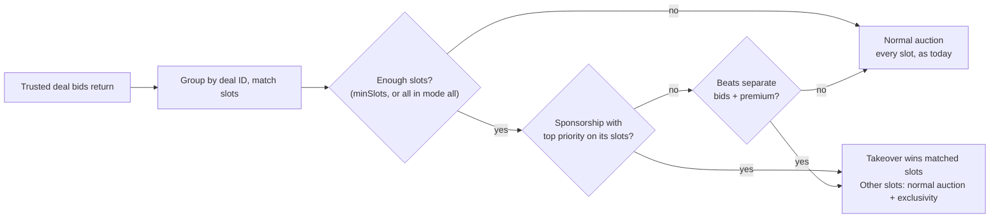

# Page Bundle Auction — Prebid Module Spec

**Status:** Draft v0.2 · 2026-11-14 · Proposed as an extension of [prebid/Prebid.js#15719](https://github.com/prebid/Prebid.js/issues/15719)

## Problem

Today no open-market auction lets one buyer win several ad slots on the same page together. Prebid and OpenRTB auction each slot (`imp`) on its own, and a bidder has no way to say "these slots together, or none."

The only way to buy a whole page is a roadblock in Google Ad Manager, and for programmatic buying [GAM supports roadblocks only as Programmatic Guaranteed deals](https://support.google.com/admanager/answer/10848368). Each one is negotiated with a single publisher, so whole-page buying can't scale across the open web.

This spec proposes a **page bundle auction** for Prebid.js. One buyer can bid for every matching slot on a page view through a deal. The bundle wins either by deal priority (a sponsorship takeover) or by paying the publisher more than the normal per-slot auction would.

## How this builds on current Prebid work

This spec reuses the deal metadata and trust model Prebid.js already ships, rather than adding a parallel mechanism.

| Prebid work | Status | What this spec takes from it |
| --- | --- | --- |
| [#15602](https://github.com/prebid/Prebid.js/issues/15602): standard deal metadata, `ext.prebid.deal` normalized to `bid.meta.deal` | Done (`meta.deal` shipped in 11.43) | Takeover fields live inside the same object: `ext.prebid.deal.takeover`. |
| [#15816](https://github.com/prebid/Prebid.js/pull/15816): priority bids (`allowPriorityBids`, `bid.priority`, `priorityAdjustedCpm`) | Merged Oct 2026 | Only bids from trusted bidders can be takeovers. Priority and `priorityAdjustedCpm` are used in the decision rule. |
| [#15719](https://github.com/prebid/Prebid.js/issues/15719): whole page takeover on deal response | Open | This spec is a proposed design for it: the all-or-nothing takeover described there is mode `all` below. |

What this spec adds beyond #15719:

- **Partial takeovers** (mode `max`): win as many matching slots as possible, with a minimum count.
- **A revenue-safe rule** for non-sponsorship takeovers: the bundle must beat the sum of the best separate bids on its slots.
- **Exclusivity:** keep named competitors or categories out of the page's other slots.
- **A demand path through deal IDs**, so buyers need no DSP changes.

## Goals and non-goals

Goals:

- One buyer wins **as many matching slots as possible** on a page view, with a minimum count the buyer sets, or **every slot** (mode `all`, as in #15719).
- For non-sponsorship takeovers, the publisher never earns less than with the normal per-slot auction for those slots.
- An optional **exclusivity** setting keeps named competitors or categories out of the other slots on the page.
- Reuse `meta.deal`, `allowPriorityBids` and `bid.priority`. No new trust model.
- Open source (Apache 2.0, the same license as Prebid.js).

Non-goals for v1:

- Letterboxing (serving a smaller creative in a larger slot). Sizes must match exactly.
- Video, native and CTV ad pods. Banner only.
- Changing how GAM runs its own auction (AdX and direct line items). The module works through key-values and line items.

## Slot matching

A slot is eligible for a takeover only if the takeover deal returned a bid for it, in a size the slot accepts. There is no letterboxing.

- **Grouping:** bids belong to the same takeover when they share a `dealId` and come from the same bidder, within one auction (one `pbjs.requestBids` call). Grouping stays inside Prebid.js, because Prebid's transaction ID no longer works across exchanges.
- **Repeated sizes:** one creative can fill several slots of the same size. Each slot's bid carries its own creative, because GAM won't serve the same creative twice on a page.

Example with 6 slots and a takeover deal with 3 sizes (728x90, 300x250, 300x600):

| Slot | Accepts | Result |
| --- | --- | --- |
| top | 728x90, 970x250 | Takeover (728x90) |
| right-1 | 300x250, 300x600 | Takeover (300x600) |
| right-2 | 300x250 | Takeover (300x250) |
| in-content | 300x250 | Takeover (300x250, second copy) |
| skyscraper | 160x600 | Normal auction |
| footer | 970x90 | Normal auction |

The takeover matches 4 of 6 slots. The other 2 run the normal auction, with exclusivity rules applied.

## Takeover fields in the deal object

A takeover is a set of ordinary per-slot deal bids. Each carries the same `dealid`, and its `ext.prebid.deal` object carries a `takeover` member. The shared OpenRTB converter normalizes it to `bid.meta.deal.takeover`, in camel case, alongside the existing deal fields.

```json
{
  "impid": "imp-1",
  "dealid": "TKO-ACME-01",
  "price": 18.00,
  "w": 300,
  "h": 250,
  "ext": {
    "prebid": {
      "deal": {
        "type": 3,
        "cpm": 18.00,
        "takeover": {
          "mode": "max",
          "min_slots": 3,
          "exclusivity": {
            "adomain": ["opponent.com"],
            "cat": ["IAB11-4"]
          }
        }
      }
    }
  }
}
```

| Field (OpenRTB → `meta.deal.takeover`) | Type | Meaning |
| --- | --- | --- |
| `mode` → `mode` | `max` or `all` | `max` = as many matching slots as possible (the default). `all` = every slot on the page, or none (#15719). |
| `min_slots` → `minSlots` | integer | The takeover is dropped if fewer slots match. Ignored in mode `all`. |
| `exclusivity.adomain` → `exclusivity.adomain` | array | Advertiser domains blocked from the other slots on the page. |
| `exclusivity.cat` → `exclusivity.cat` | array | IAB content categories blocked from the other slots on the page. |

Everything else comes from fields that already exist:

- **Grouping key:** `bid.dealid` (with the bidder).
- **Price per slot:** `bid.price`, as for any bid.
- **Deal type, priority and `priority_adjusted_cpm`:** the existing `ext.prebid.deal` fields.

**Trust:** `meta.deal.takeover` is acted on only for bids from trusted bidder requests, under the same rule as priority bids: `bidderSettings[adapterCode].allowPriorityBids` for client adapters, `s2sConfig.allowPriorityBids` for Prebid Server. A takeover can change what serves in slots the bidder didn't bid on, so it needs the same trust boundary. Takeover fields on untrusted bids are ignored, and the bids compete normally.

## Demand path: takeovers through deal IDs

In v1, buyers send takeover bids through ordinary private marketplace (PMP) deals, so no DSP needs to change. A buyer on DV360 or The Trade Desk targets a takeover deal the same way as any other deal, and the SSP adds the takeover fields.

1. **The publisher (or SSP) creates a takeover deal**, for example `TKO-ACME-01`, covering the slots and sizes eligible for takeovers. The deal carries its takeover terms: mode, `min_slots`, exclusivity, and optionally a deal type and priority.
2. **The buyer targets the deal in their DSP** with a fixed CPM per slot, using a creative for each matching size.
3. **The DSP bids on each slot separately**, as for any PMP deal, with the same deal ID on every bid.
4. **The SSP (its Prebid adapter, or Prebid Server) recognizes the takeover deal** and adds `ext.prebid.deal.takeover` to each bid, using the deal's terms.
5. **Prebid.js groups the trusted bids by deal ID** and applies the decision rule. Slots where the DSP didn't bid count as unmatched.

| Who | What changes | Effort |
| --- | --- | --- |
| Buyer | Nothing new: target a PMP deal | None |
| SSP | Adds `ext.prebid.deal.takeover` to bids on takeover deals | Small: the deal object already exists |
| Publisher | Trusts the SSP (`allowPriorityBids`), sets up GAM line items, creates takeover deals | Moderate, done once |

Limits of the deal path:

- **Missing bids:** the DSP decides each slot's bid separately, so it may not bid on every slot (pacing, frequency caps, brand-safety filters). Buyers should turn off per-page frequency caps on takeover deals. `minSlots` protects them from winning only one or two slots.
- **Per-slot prices only:** the DSP can't send one price for the whole page. The takeover total is the sum of its per-slot bids.

## Decision rule

How a takeover wins depends on its deal type. Sponsorship takeovers win by priority, as #15719 describes. Every other takeover must beat the per-slot auction on revenue.



**Sponsorship takeovers** (`meta.deal.type` = sponsorship): the takeover wins if, on every matched slot, its bid ranks first under Prebid's existing priority comparison (`bid.priority`, lower wins, then desirability). No revenue test applies, the same as for single-slot sponsorship bids today.

**All other takeovers:** the takeover wins its matched slots only if its total beats the sum of the best separate bids on those slots, plus a premium the publisher sets:

```math
\sum_{i=1}^{n} \text{takeoverValue}_i > (1 + p) \cdot \sum_{i=1}^{n} \text{bestBid}_i
```

- n = the number of matched slots.
- takeoverValue = the takeover's desirability on each slot. This is `priorityAdjustedCpm` when present, otherwise CPM, after the usual adjustments.
- bestBid = the desirability of the best other bid on each slot (the slot's floor if it has no other bid).
- p = the publisher's premium (for example 0.10).

Further rules:

- **Exclusivity cost:** if the takeover blocks advertisers from the other slots, the best bids lost on those slots are added to the right-hand side. The takeover pays for what it blocks.
- **Mode `all`:** the takeover must cover every slot in the auction. Following #15719, a mode `all` takeover is also rejected if any slot on the page has already rendered another bid, for example a lazy-loaded or refreshed slot.
- **Two takeovers on one page:** the higher-ranked one wins (sponsorship first, then priority, then total value). The other is dropped, not split.
- **Ties** go to the normal auction.
- **Limit:** Prebid only sees header bids, not AdX or direct line items in GAM. So a takeover that wins in Prebid can still lose a slot to AdX inside GAM. The GAM handoff below is designed to prevent this.

## GAM handoff

When a takeover wins, Prebid.js sets key-values on each matched slot so that dedicated takeover line items in GAM serve it ahead of AdX.

| Key | Example value | Purpose |
| --- | --- | --- |
| `hb_tko` | `1` | Marks the slot as won by a takeover. |
| `hb_deal` | `TKO-ACME-01` | Standard Prebid deal key; ties the slots together for reporting. |
| `hb_pb` | `18.00` | Price bucket, as standard Prebid. |
| `hb_excl` | `pol-opp` | Turns on the GAM competitive exclusion label for the other slots. |

Publisher setup in GAM:

1. **Single-request mode (SRA) on.** GAM needs every slot in one request to serve slots as a group.
2. **Takeover line items** targeted to `hb_tko=1`, at a priority above price priority and AdX (for example Sponsorship), using the Prebid Universal Creative.
3. **"Display creatives" setting:** "As many as possible" for mode `max`, "All" for mode `all`.
4. **Competitive exclusion labels** mapped to `hb_excl` values, to enforce exclusivity on the other slots.

Open question: takeover line items at Sponsorship priority bypass AdX entirely. Publishers may want a GAM-side check (for example a floor at the takeover's total) before agreeing to that.

## Publisher config

Trust comes from the existing `allowPriorityBids` settings. The takeover rules are set with one `pbjs.setConfig` block.

```javascript
// Trust: the same setting priority bids already use
pbjs.bidderSettings = {
  exampleSSP: { allowPriorityBids: true }
};

// Takeover rules
pbjs.setConfig({
  takeover: {
    enabled: true,
    premium: 0.10,              // non-sponsorship takeovers must beat separate bids by 10%
    modes: ['max', 'all'],      // which takeover modes are accepted
    minSlotsFloor: 2,           // ignore takeovers that ask for fewer slots
    excludeAdUnits: ['footer'], // slots never sold in a takeover
    allowExclusivity: true,
    exclusivityLabels: { 'pol-opp': ['IAB11-4'] }
  }
});
```

| Setting | Default | Meaning |
| --- | --- | --- |
| `premium` | 0.10 | How much more than the separate bids a non-sponsorship takeover must pay. |
| `modes` | `['max']` | Which takeover modes are accepted. |
| `minSlotsFloor` | 2 | Takeovers asking for fewer slots are ignored. |
| `excludeAdUnits` | none | Slots the publisher never sells in a takeover. |
| `allowExclusivity` | false | Whether takeovers may block advertisers from other slots. |
| `exclusivityLabels` | none | Maps `hb_excl` values to the categories they block. |

Open question for maintainers: should this be core behavior (as #15719 suggests) or an optional module? The decision rule needs all bids in the auction at once, so it would run where Prebid selects winners for targeting.

## Contribution plan (Prebid.js rules)

Prebid's [contributing guide](https://github.com/prebid/Prebid.js/blob/master/CONTRIBUTING.md) shapes how this is built:

- **Fork and pull request** against `master` in `prebid/Prebid.js`.
- **Test coverage above 80%** on added code, with all existing tests passing. Tests use Mocha, Chai and Sinon.
- **TypeScript types** for the public interface: the `takeover` config block and `meta.deal.takeover`.
- **Docs** go in a separate pull request to [prebid.github.io](https://github.com/prebid/prebid.github.io).

Draft types, extending the existing deal metadata:

```typescript
export type TakeoverMode = 'max' | 'all';

export interface TakeoverExclusivity {
  adomain?: string[];
  cat?: string[];
}

export interface TakeoverMeta {
  mode?: TakeoverMode;        // default 'max'
  minSlots?: number;          // required for mode 'max'
  exclusivity?: TakeoverExclusivity;
}

// Added to the existing deal metadata on bid.meta.deal
export interface DealMeta {
  // existing fields: type, cpm, priorityAdjustedCpm, onSchedule, priority
  takeover?: TakeoverMeta;
}

export interface TakeoverConfig {
  enabled: boolean;
  premium?: number;           // default 0.10
  modes?: TakeoverMode[];     // default ['max']
  minSlotsFloor?: number;     // default 2
  excludeAdUnits?: string[];
  allowExclusivity?: boolean; // default false
  exclusivityLabels?: Record<string, string[]>;
}
```

Test plan, one `describe` block per area:

- **Normalization:** `ext.prebid.deal.takeover` to `meta.deal.takeover`; malformed fields ignored; untrusted bids ignored.
- **Slot matching and grouping:** grouping by deal ID and bidder; repeated sizes; unmatched slots.
- **Decision rule:** sponsorship by priority; non-sponsorship wins, loses, ties; the premium; the exclusivity cost; `minSlots`; mode `all`, including a slot that already rendered.
- **Two takeovers:** ranking and dropping.
- **Targeting:** `hb_tko` and `hb_excl` set only on won slots.
- **Config:** defaults, disabled, excluded ad units.

## Edge cases and roadmap

Edge cases:

- **Lazy-loaded slots:** v1 includes only the slots in the first `requestBids` call. In mode `max`, slots loaded later run the normal auction. In mode `all`, see the decision rule.
- **Page refresh:** a refreshed slot runs the normal auction, unless the takeover was in mode `all`.
- **A slot loses inside GAM anyway:** the page ends up partly taken over. The win is reported with the slot count the takeover actually got, so the buyer pays only for slots served.
- **Consent:** takeover bids follow the same consent and privacy modules as other bids.

Roadmap:

- [x] Check Prebid.js issues for earlier proposals: found [#15719](https://github.com/prebid/Prebid.js/issues/15719)
- [ ] Share this spec on #15719 and ask maintainers which parts fit
- [ ] Collect feedback from publishers and buyers
- [ ] Find one SSP partner to add `ext.prebid.deal.takeover` to its takeover deals
- [ ] Build a prototype on a fork and test it with one publisher and one takeover deal
- [ ] Submit upstream to Prebid.js, with tests and a docs page on docs.prebid.org

Interested in helping, as a publisher, SSP or buyer? Open an issue in this repo.

## Sources

- [Prebid.js #15719: Whole page take over on deal response](https://github.com/prebid/Prebid.js/issues/15719)
- [Prebid.js #15602: Standardize deal metadata and sponsorship-aware selection](https://github.com/prebid/Prebid.js/issues/15602)
- [Prebid.js PR #15816: Priority bids](https://github.com/prebid/Prebid.js/pull/15816)
- [GAM: Roadblock creatives](https://support.google.com/admanager/answer/2666920)
- [GAM: Programmatic Direct creatives and roadblocks](https://support.google.com/admanager/answer/10848368)
- [Prebid.js contributing guide](https://github.com/prebid/Prebid.js/blob/master/CONTRIBUTING.md)
- [PPC Land: Prebid transaction ID change](https://ppc.land/iab-tech-lab-challenges-prebid-transaction-id-changes/)
